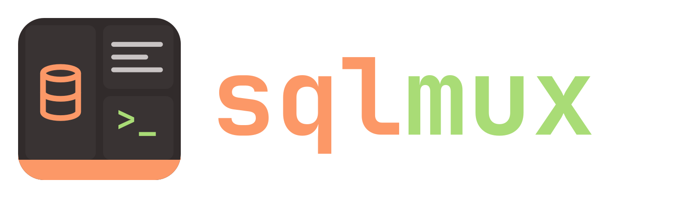
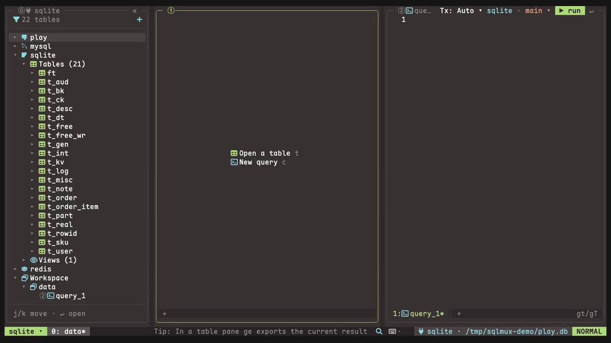

<div align="center">



**A terminal database client organized the way tmux is: sessions, windows, panes and tabs.**<br>
PostgreSQL, MySQL, SQLite and Redis. vim keys everywhere, the mouse too.

[](https://github.com/kackerx/sqlmux/releases)
[](https://github.com/kackerx/sqlmux/actions/workflows/ci.yml)
[](LICENSE)



</div>

## Install

```sh
brew install kackerx/tap/sqlmux
```

| | |
|---|---|
| Homebrew (macOS, Linux) | `brew install kackerx/tap/sqlmux` |
| npm (no Go needed) | `npm install -g sqlmux`, or `npx sqlmux` to try it |
| Go 1.26+ | `go install github.com/kackerx/sqlmux/cmd/sqlmux@latest` |
| Binaries | macOS and Linux, amd64 and arm64, on the [Releases page](https://github.com/kackerx/sqlmux/releases), with `checksums.txt` |

Then open something:

```sh
sqlmux ./app.db                                       # a SQLite file
sqlmux "postgres://me@localhost:5432/app?sslmode=disable"   # or mysql://…
sqlmux                                                # no connections yet: a form to add one
```

The [quickstart](docs/quickstart.md) goes from here to editing your first row.

## Features

- **tmux inside.** Sessions, windows, split panes and tabs, with `SPC` as the leader (`SPC %` splits, `SPC c` opens a window, `SPC s` lists sessions). Each session sees all your connections. The layout you quit from comes back next time, and you can save named layouts.
- **Edit tables in place.** Change cells, add and delete rows, then `C-s` saves everything in one transaction. Enum, boolean and time columns get pickers; long text and JSON open in a value editor.
- **Table tabs.** A WHERE input with completion, history and favorites; multi-column ORDER, LIMIT, paging, a column picker, transpose, filter by a cell's value, export to CSV or JSON.
- **A vim editor for SQL**, diff-tested against nvim: operators and text objects, VISUAL and block selection, registers, search, `:s`, formatting with `gq`. Results go to a bottom pane, one tab per query, which you can pin.
- **Completion and signature hints.** Tables, columns, keywords and functions as you type, with fuzzy matching; enum values where a value goes; a line above the cursor that says which column the value you are typing is for.
- **Command palette** (`C-p`) for every command, table, tab, window and session, with a DDL preview. **Quick SQL** (`;`) runs a one-off statement from anywhere.
- **JSON view** (`gj`) of a table page or a result, read-only with vim movement and search.
- **Redis**: a tree of databases, namespaces and keys read with `SCAN`; each key (string, hash, list, set, zset, stream, RedisJSON) as an editable table; a console with completion and signatures from the server's `COMMAND DOCS`. See [Redis](docs/redis.md).
- **Every key can be rebound**, per pane type, plus vim-style maps (`J = "5j"`). `vim = false` gives plain editors and arrow keys.
- Passwords from the OS keychain, a command (`pass`, `op`, …) or an environment variable; SSH tunnels through `~/.ssh/config`; read-only connections; manual transactions; themes; Nerd Font or ASCII icons; English or Chinese UI.

## Keys and configuration

- [Keys](docs/keys.md): every action and its default keys. `sqlmux keys` prints the same list, and `?` in any pane shows the keys that work there.
- [Configuration](docs/config.md): `config.toml`, `connections.toml`, `keymaps.toml`, themes and layouts. `sqlmux keys --format toml` writes a complete `keymaps.toml` to start from.
- [Changelog](CHANGELOG.md): what changed in each version, and how to migrate. sqlmux is 0.x, so a minor version can change keys or config.

## Build from source

With Go 1.26+ and [just](https://github.com/casey/just): `just build` puts the binary in `bin/`, and `just --list` shows the tests, lint and the sample databases (`just db-up` starts PostgreSQL and MySQL with sample data in Docker). Without just:

```sh
go build -o bin/sqlmux ./cmd/sqlmux
```

Built with [Bubble Tea v2](https://github.com/charmbracelet/bubbletea). The design notes are in [specs/](specs/tech-design.md) (in Chinese).

## License

[MIT](LICENSE)
